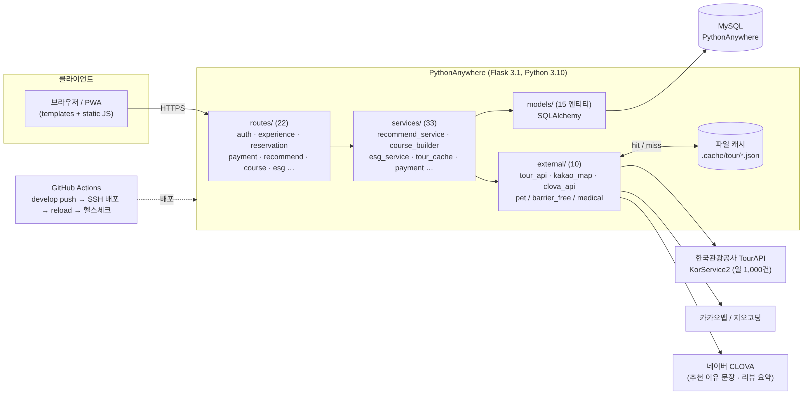
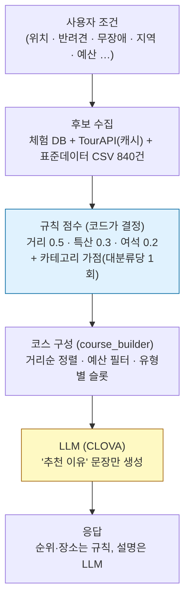
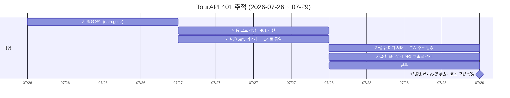
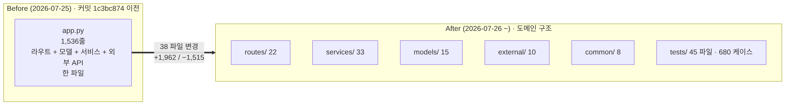

# FarmLink — 충청권 농촌관광 체험 예약 · AI 추천 코스 플랫폼

> 농가는 과잉 생산분을 폐기하고, 소비자는 "체험할 수 있는 농장"을 찾기 어렵다.
> 두 문제를 **체험 예약** 하나로 잇고, 공공 관광 데이터를 붙여 체험 전후의 **코스**까지 추천한다.

| 항목 | 내용 |
|---|---|
| 기간 | 2025.09 ~ 2026.09 (공모전 제출 2026.09.21) |
| 팀 | 4명 — PM 1 · 백엔드 2 · 프론트 1 |
| **내 역할 (윤우성, 백엔드)** | ESG 점수 · 한국관광공사 TourAPI 연동 · AI 추천 코스 · 조건 카테고리/가점 · 역제안 · 파일 캐시 · 배포/CI · 팀 개발 규칙 문서 |
| 스택 | Python 3.10 · Flask 3.1 · SQLAlchemy · MySQL · PWA · PythonAnywhere · GitHub Actions |
| 외부 API | 한국관광공사 TourAPI(KorService2 · 반려동물 · 무장애 · 의료) · 카카오맵 · 네이버 CLOVA |
| 성과 | 2025 ICT이노베이션 SW개발 부문 **충청권 대상** · 2026 관광데이터 활용 공모전 **예비심사 통과** |
| 코드 | 서버 코드 10,335줄 · 테스트 45파일 / 680 케이스 · 본인 커밋 174건 |

팀원 담당: 건태(백엔드 — 회원·권한·농장·체험·예약·결제·리뷰·관리자) · 준형(프론트 전 화면) · 대윤(PM — 기획·조사·문서·발표)

---

## 1. 아키텍처



요청은 `routes → services → models/external` 한 방향으로만 흐른다. 외부 API 호출은 전부 `external/`에 모아 두고, 그 결과를 쓰는 규칙(점수·코스·필터)은 `services/`에만 있다. 외부 API가 죽어도 서비스가 멈추지 않도록 `external/`은 빈 리스트를 돌려주고 `services/`가 폴백을 결정한다.

```
app.py            앱 생성 · 블루프린트 등록
routes/   (22)    HTTP 입출력만. 비즈니스 로직 없음
services/ (33)    추천 점수 · 코스 구성 · ESG · 결제 · 캐시 등 규칙
models/   (15)    SQLAlchemy 엔티티
external/ (10)    TourAPI · 카카오맵 · CLOVA 래퍼 (예외를 밖으로 내보내지 않음)
common/   (8)     응답 포맷 {success,data,error} · 상수 · 검증 · 인증
tests/    (45)    pytest 680 케이스
.github/workflows/deploy.yml   develop push → SSH 배포 → reload → 헬스체크
```

## 2. 기술 결정 — 선택지와 버린 이유

| 결정 | 선택지 | 고른 것 | 버린 이유 | 근거 |
|---|---|---|---|---|
| **추천 코스 생성** | ① LLM이 장소·순서까지 생성 ② 규칙 점수로 순위, LLM은 설명만 | **②** | ①은 같은 입력에 다른 코스가 나오고(재현성), 없는 장소를 지어낼 수 있으며(환각), 왜 그 순서인지 설명할 수 없다. 심사·면접에서 "왜 이 장소인가"에 답하려면 점수가 코드에 있어야 했다 | `services/course_builder.py` 2행 주석, `services/recommend_service.py` |
| **외부 API 응답 캐시** | ① 프로세스 메모리 ② DB 테이블 ③ 파일 | **③ 파일** | PythonAnywhere는 워커가 여럿이라 ①은 워커 수만큼 효과가 나뉜다. ②는 마이그레이션이 필요해 동시 작업 중인 팀원 모델 영역을 건드린다. 파일은 워커가 공유하고 재시작 후에도 남는다 | 커밋 `fad523ca`, `services/tour_cache.py` 머리 주석 |
| **외부 데이터 적재** | ① DB 사전 적재 ② 요청 시 실시간 호출 | **②로 시작 → 병목 확인 후 ③ 캐시 추가** | 처음부터 적재하면 갱신 주기·저장 구조를 먼저 정해야 해 착수가 늦어진다. 실시간으로 시작하고, 일일 한도 소진이 실제로 발생한 9월에 캐시를 붙였다 | 7/29 → 9/13 커밋 순서 |
| **앱 전환** | ① 네이티브 앱 ② PWA | **② PWA** | 웹 코드를 그대로 재사용, 별도 앱 코드 없이 manifest·서비스워커만 추가. 대신 서비스워커 캐시 전략을 두 번 고쳤다(아래 트러블슈팅) | `routes/pwa.py`, 커밋 `1321e8b2` `18fe1033` |
| **ESG 점수 축** | ① 데이터 있는 항목 전부 합산 ② E·S·G 축별 배분 | **② E55·S35·G10** | ①로 두니 무농약+유기농만으로 65점이 나와 E에 쏠리고 G가 비었다. 실제 데이터가 있는 항목만 쓰되 축별 상한을 둬 균형을 맞췄다 | `services/esg_service.py` 10~27행 |

### 추천 흐름 — 순위는 규칙, 설명은 LLM



```python
# services/recommend_service.py
def score_components(distance, max_p, current_p, is_specialty):
    distance_score     = max(0, 1 - (distance / 50))          # 50km 밖은 0
    availability_score = (max_p - current_p) / max_p if max_p > 0 else 0
    specialty_score    = 1.0 if is_specialty else 0
    w1, w2, w3 = 0.5, 0.3, 0.2
    return {'distance': w1 * distance_score,
            'specialty': w2 * specialty_score,
            'availability': w3 * availability_score}
```

같은 함수를 `calculate_score`(합산)와 `recommendation_reason`(최대 기여 요소 선택)이 공유한다. LLM에는 이미 정해진 순위와 기여 요소만 넘겨 "왜 추천했는지" 문장을 받는다.

## 3. 트러블슈팅

### 3-1. TourAPI 401 — 3일 (7/26 ~ 7/29)



**상황** 관광지 데이터를 AI 추천 코스에 넣는 작업. 키 신청부터 코스 구현 커밋까지 4일, 그중 모든 요청이 401로 거부되는 문제에 3일.

**왜 어려웠나** 401은 키 오타 · 활용신청 누락 · 활성화 대기 · 주소 오류가 **전부 같은 응답**이라 응답만으로 구분이 안 된다. 코딩 도구도 "키 문제 → 실행 환경이 외부망 차단 → 다시 키 문제"로 진단을 바꿨다.

**가설 배제 순서**
1. `.env`의 관광공사 키 4개 길이가 제각각 → 계정당 인증키는 1개임을 확인하고 통일 (내 설정 오류 제거)
2. 옛 서버 `api.visitkorea.or.kr`가 폐기돼 `resultCode 12`, 국문 관광정보만 `_GW` 게이트웨이로 이전된 공지 확인 → 주소 검증 (내 코드 오류 제거)
3. 코드 · 실행 환경 · 환경변수를 전부 빼고 **브라우저 주소창에서 직접 호출** → "키 자체가 인증되는가"만 격리
4. 가장 단순한 오퍼레이션(`areaCode2`)까지 서비스단 오류 코드 없이 맨 `Unauthorized`(Server 헤더 없음) → 요청이 서비스에 닿기 전 **게이트웨이에서 거부 = 키 미등록 상태**로 결론

**판단** 더 붙잡는 건 소모적이라 재발급을 걸어 두고 카카오 지오코딩 등 관광공사와 무관한 기능으로 이동. 신청 3일 뒤 키가 활성화되며 **같은 주소에서 95건 수신**. 코드는 처음부터 맞았고 수정 커밋은 없다.

**남은 것** 외부 API 문제는 코드를 의심하기 전에 직접 호출로 변수를 격리하는 순서를 먼저 밟게 됐다. 공공데이터포털 키는 승인 뒤에도 게이트웨이 반영까지 하루 이상 걸릴 수 있다.

### 3-2. KTO 일일 한도 1,000건 소진 → 파일 캐시 (9/13, `fad523ca`)

**증상** AI 추천 페이지가 코스 카드마다 `/api/experiences/<id>/course`를 부르고, 그 한 번이 KTO를 2~4회 호출. 심사 시연 중 한도가 소진되면 코스가 비어 보인다.

**Before → After**

```python
# Before: external/tour_api.py — 매 요청마다 KTO 호출
def find_nearby_places(lat, lng, radius_m, content_type_id=None, rows=None):
    resp = requests.get(KTO_URL, params=..., timeout=5)
    return [_to_place(i) for i in _items(resp)]
```

```python
# After: 좌표를 소수 2자리(≈1.1km)로 반올림한 키로 파일 캐시. 예외는 절대 밖으로 내보내지 않음
def find_nearby_places(lat, lng, radius_m, content_type_id=None, rows=None):
    cache_key = tour_cache.make_key(lat, lng, f"{radius_m}:{rows}", content_type_id)
    cached = tour_cache.get(cache_key)          # 살아있으면 리스트, 없거나 손상이면 None
    if cached is not None:
        return cached
    places = ... # KTO 호출
    tour_cache.set(cache_key, places)           # 빈 결과도 짧은 TTL로 저장 → 재조회로 한도 태우는 것 방지
    return places
```

- 좌표를 반올림해도 결과가 틀리지 않는 이유: 캐시는 **후보 목록**만 공유하고, `course_builder._sorted_by_distance()`가 체험의 실제 좌표로 거리를 다시 계산한다.
- 격자 경계에서 수십 m 차이로 키가 갈리는 경우는 캐시를 못 나눠 쓸 뿐, 최악이 캐싱 전과 같은 동작이다.
- 테스트 `tests/test_tour_cache.py` 194줄로 TTL · 손상 파일 · 빈 결과 · 최대 엔트리를 검증.

### 3-3. 그 외 (커밋으로 추적 가능)

| 증상 | 원인 | 조치 | 커밋 |
|---|---|---|---|
| 무장애 여행지가 항상 빈 리스트 | 관광공사 무장애·반려동물 API가 v2로 바뀌었는데 URL 미갱신 | URL v2 교체 → 무장애 필터 복구 | `3010caad` |
| 반려견 필터가 동작 안 함 | 팀원 리팩터로 조건이 `companion_type` 하위로 이동했는데 판정 코드 미갱신 | 판정 코드를 새 구조에 맞춤 | `900fb6f3` |
| 배포해도 옛 CSS·JS가 보임 | PWA 서비스워커가 cache-first | SWR → network-first로 두 번 전환 | `1321e8b2` `18fe1033` |
| 조건 밖 장소가 추천에 섞임 | ESG·조건을 정렬 기준으로만 써서 필터가 안 됨 | 정렬 → 필터로 변경 | `d4c46f51` |

## 4. Before → After: 단일 파일에서 도메인 구조로 (7/26, `1c3bc874`)



`app.py` 1,536줄에 라우트·모델·서비스·외부 API가 다 있었다. 백엔드 2명이 같은 파일을 고치며 충돌이 잦았고, 테스트를 붙일 단위가 없었다. 38개 파일로 분할(+1,962 / −1,515)한 뒤 `tests/`가 4개 → 45개 파일로 늘었다. 분할 기준은 "팀원이 내 파일을 안 건드려도 되는가"였고, 그래서 외부 API 캐시를 DB가 아닌 파일로 한 결정(2절)과도 이어진다.

## 5. 숫자

| 구분 | 값 | 출처 |
|---|---|---|
| 조건 필터 | 7개 → **11개 대분류 · 223개 세부 옵션** (대분류 탭 + 세부 체크박스, 대분류당 1회 가점) | `common/search_categories.py` |
| 공공데이터 | 관광지정보 표준데이터 **840건** CSV 연동(충남 43건) | `external/tour_csv.py`, `data/` |
| 외부 API | TourAPI 4종 + 카카오맵 + CLOVA, 일일 한도 1,000건 대응 | `external/` |
| 테스트 | **45파일 · 680 케이스** (pytest) | `tests/` |
| 배포 | develop push → 자동 배포(SSH · reload · 헬스체크), 동시 배포 방지 `concurrency` | `.github/workflows/deploy.yml` |
| 커밋 | 본인 174건 / 전체 497건 (2026.07 ~ 09 집중) | `git log` |
| 수상 | ICT이노베이션 충청권 대상(2025.10) · 관광데이터 공모전 예비심사 통과(2026.05) | — |

측정하지 못한 것: **응답시간 · 동시 접속 부하.** k6 부하테스트를 계획했으나 실측 전에 프로젝트가 종료됐다.

## 6. 한계와 다시 한다면

- **팀 규칙을 만들었지만 끝까지 지키지 못했다.** `docs/team_rules.md`에 브랜치·커밋·PR(300줄 · 본인 머지 금지)·리뷰 체크리스트·DoD를 정했지만, 실제 머지 커밋 대부분이 `develop` pull 머지이고 PR은 1건이다. 다음엔 문서보다 **브랜치 보호 설정**을 먼저 건다.
- **부하 수치가 없다.** 캐시가 "한도 소진을 막았다"는 건 확인했지만 응답시간 개선 폭은 재지 못했다.
- **Flask 단일 파일에서 출발했다.** 도메인 분할로 수습했지만, 다시 시작한다면 Spring Boot + JPA + Flyway로 가고, 외부 API 캐시는 Redis로 둔다. 이 스택을 쓰는 K-OSP에서 그 차이를 경험했다.
- **AI 코딩 도구 사용.** 상당량의 코드를 Claude Code로 작성했다. 그래서 커밋 메시지와 모듈 머리 주석에 "왜 이렇게 했는지"를 남기는 규칙을 두었고(`fad523ca`, `services/tour_cache.py`), 401처럼 도구의 진단이 흔들릴 때는 도구를 빼고 직접 격리했다.

## 7. 관련 문서

- [팀 개발 규칙](docs/team_rules.md) · [머지 워크플로](docs/merge_workflow.md) · [API 명세](docs/api.md) · [UI 스펙](docs/ui_spec.md)
- [ADR(아키텍처 결정 기록)](docs/adr/) — 분할 · 추천 방식 · 캐시

---

## 8. 실행 방법 · 기술 스택 · 구조 (기존 내용)

<details>
<summary>펼치기</summary>

### 3. 기술 스택 (Tech Stack)

- **Backend**: Python, Flask, SQLAlchemy
- **Database**: MySQL
- **Frontend**: HTML, CSS, JavaScript, Bootstrap, jQuery
- **APIs & Libraries**: Kakao Maps API, FullCalendar.js, Font Awesome
- **Deployment**: PythonAnywhere

### 4. 로컬 실행 방법 (How to Run)

### Prerequisites
- Python 3.x
- MySQL

### Installation
1.  **프로젝트 클론**
    ```bash
    git clone https://github.com/your-username/FarmLink.git
    cd FarmLink
    ```

2.  **가상 환경 생성 및 활성화**
    ```bash
    python -m venv venv
    source venv/bin/activate  # Linux/macOS
    .\venv\Scripts\activate  # Windows
    ```

3.  **의존성 설치**
    ```bash
    pip install -r requirements.txt
    ```

### Configuration
1.  **환경 변수 설정**:
    `app.py` 파일 내에서 직접 수정하거나 환경 변수를 설정합니다. 데이터베이스 정보와 Kakao API 키가 필요합니다.

    *   `SECRET_KEY`: Flask 애플리케이션의 시크릿 키
    *   `DB_USERNAME`, `DB_PASSWORD`, `DB_HOSTNAME`, `DB_NAME`: MySQL 데이터베이스 연결 정보
    *   `KAKAO_API_KEY`: Kakao Maps API 사용을 위한 API 키

    **예시 (`app.py` 내 직접 설정):**
    ```python
    app.secret_key = 'your-secret-key'
    db_username = 'your_db_user'
    db_password = 'your_db_password'
    db_hostname = 'localhost'
    db_name     = 'farmlink_db'
    app.config['KAKAO_API_KEY'] = 'your_kakao_api_key'
    ```

### Running the Application
1.  **데이터베이스 테이블 생성**:
    Python 인터프리터를 실행하고 다음 코드를 입력하여 테이블을 생성합니다.
    ```python
    from app import app, db
    with app.app_context():
        db.create_all()
    ```

2.  **Flask 서버 실행**:
    ```bash
    flask run
    ```
    또는
    ```bash
    python app.py
    ```
    서버가 실행되면 웹 브라우저에서 `http://127.0.0.1:5000`으로 접속할 수 있습니다.

### 5. 데이터베이스 (Database)

이 프로젝트는 **MySQL**을 관계형 데이터베이스로 사용합니다. 모든 테이블 모델은 `app.py` 파일 내에 `db.Model`을 상속받는 클래스로 정의되어 있습니다. `db.create_all()` 명령어를 통해 정의된 모델에 따라 데이터베이스에 테이블이 자동으로 생성됩니다.

### 6. 프로젝트 구조 (Project Structure)

```
.
├── app.py              # Flask 메인 애플리케이션 파일 (라우트, 모델 정의)
├── requirements.txt    # Python 의존성 목록
├── README.md           # 프로젝트 설명 파일
├── static/             # 정적 파일 (CSS, JS, 이미지)
│   ├── css/
│   ├── js/
│   └── uploads/        # 사용자가 업로드한 파일 (프로필, 농장 사진 등)
└── templates/          # HTML 템플릿 파일
    ├── index.html      # 메인 페이지
    ├── login.html      # 로그인 페이지
    ├── register.html   # 회원가입 페이지
    ├── my_farm.html    # 농장주 대시보드
    └── ...             # 기타 페이지 템플릿
```


링크
kevin4201.pythonanywhere.com/


</details>
